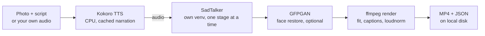

# kodros-localavatar

Makes a talking-head video from one photo and a script, entirely on your own machine. It speaks the script with an on-device voice, animates the face to match and renders a captioned MP4. The photo and the audio never leave the computer.

## Hardware and on-prem

- Linux, Python 3.12 for the CLI and Python 3.10 for the animation engine, `ffmpeg`. An NVIDIA GPU is expected for the face animation.
- Measured by the author on a shared RTX 4080 (16 GB): peak 3,118 MiB of VRAM across the process tree for a 23 second video at 9:16 with face restore. The total run took 27 min 13 s on a heavily loaded desktop. Skipping face restore (`--no-enhance`) cut a 512 px run to about 7 minutes. These are slow, loaded-machine numbers, not a benchmark.
- On CPU it works but is very slow: 58 min 10 s for 158 frames at 256 px, measured under heavy load.
- No language model is involved. Voice is Kokoro 82M on CPU. The animation model is SadTalker with GFPGAN face restore. Both SadTalker and GFPGAN come from research groups outside the US, so check that against your own policy.
- The web UI binds `127.0.0.1` and rejects foreign Host and Origin headers. The only network use is `localavatar setup`, a one-time download of the pinned SadTalker source and weights (about 2.5 GB) from GitHub. After that it needs no network.

## How it works



The script is split into sentences, voiced chunk by chunk with exact timing, then the audio drives expression and pose in SadTalker. The renderer pads or trims so the video ends with the audio, applies the aspect layout, burns captions and normalizes loudness. Before any GPU work it checks that a CUDA context can really be created, and fails in about a second with a clear message if not. `--cpu` skips the GPU.

## Stack

Python 3.12 (CLI, Kokoro ONNX, tests), Python 3.10 with torch 2.1 (SadTalker engine, separate venv), ffmpeg, a standard-library web UI.

## Build and run

```bash
git clone https://github.com/thefiredev-cloud/kodros-localavatar.git
cd kodros-localavatar
scripts/install.sh                     # two venvs, then downloads pinned weights
~/.venvs/localavatar/bin/python -m pytest -q    # 87 tests, no models needed
localavatar make --photo FACE.jpg --script script.txt --voice af_heart --out out.mp4 --captions
localavatar serve                      # http://127.0.0.1:8870/
```

Put the Kokoro files `kokoro-v1.0.onnx` and `voices-v1.0.bin` in `~/.local/share/kokoro` (or set `KOKORO_DIR`). `localavatar doctor` reports missing SadTalker weights, whether the two Kokoro files exist, free VRAM and whether a `LOCALAVATAR_GPU_BLOCK` process is running. It does not create a CUDA context; `make` does that check before any GPU work. [BUILD.md](BUILD.md) has the full steps, results and the model comparison.

## Limits

- Kokoro has fixed voices and cannot clone a voice. Use `--audio` with your own recording.
- One photo in, one face out. The body stays still, head motion is subtle, profile or occluded faces fail detection.
- The model licenses are research-oriented in parts. SadTalker's face-reconstruction net used the Basel Face Model and GFPGAN was trained on FFHQ (CC BY-NC-SA). Get a license review before selling output or shipping the weights.
- No translation, dubbing, stock avatars or multi-scene editing.

## License

Copyright 2026 Tanner Osterkamp. All rights reserved. See [LICENSE](LICENSE). The source is public to read; ask before reuse.
